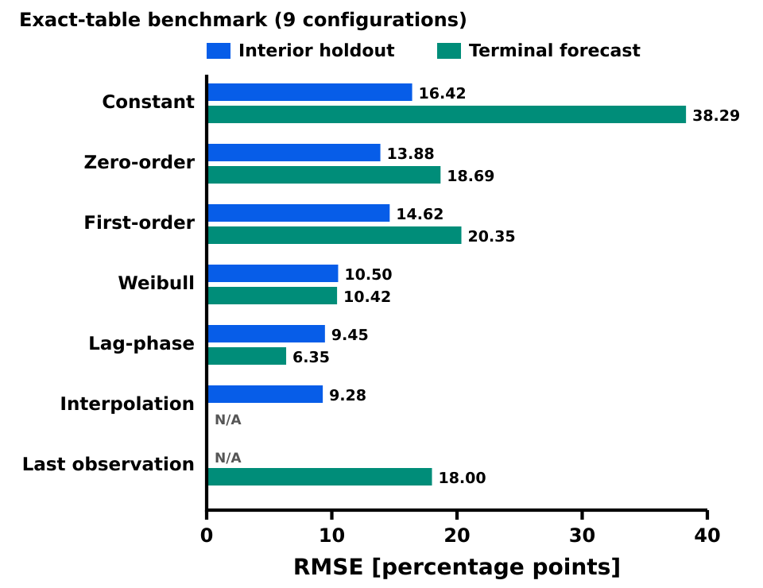

# E03 — Marine ageing and strength-loss kinetics

**Status:** Executed exploratory comparison, 27 November 2026.

## Design
The 71-record E02 mechanical core was read directly from the committed CSV. Sixteen condition-specific series were identified using baseline ID, exposure condition and temperature. Nine exact-table twine series form the primary comparison (36 positive-time observations). Zhou cotton is a supplementary complete model comparison; Zhou jute, Zhou sisal and biotic rayon are supplementary one-parameter comparisons. Abiotic rayon and the two PBS/PBAT temperature series have fewer than three positive-time observations and are retained descriptively, without fitting. Shared baselines are not counted as independent observations.

The models fix R(0)=100 and fit unweighted squared error at positive times. Zero-order is clipped at zero; first-order and Weibull are monotone exponential models; the lag model remains at 100 until the fitted lag. Data above 100 are retained. Time is scaled by the maximum training time for numerical optimisation. Weibull shape is profiled from 0.25 to 4 in increments of 0.05; lag from 0 to 0.8 of maximum training time in increments of 0.01; rate is searched on a bounded grid (0–5 for zero-order, 0–30 for other models in scaled units), with golden-section refinement. These are computational choices, not physical priors or guarantees of a global optimum. Because uncertainty estimates differ across sources, fits are unweighted. 

For every eligible series, each positive time point is held out once. Interior holdouts use both earlier and later observations; terminal forecasts use only earlier observations. Baseline-normalised linear interpolation is the interior comparator, and last observation is the terminal comparator. All errors are expressed in percentage points of initial strength. These evaluations are conditional on the measured baseline and are not independent particle or study validation.

## Primary results

| Model | Interior RMSE (27 predictions) | Terminal RMSE (9 predictions) |
|---|---:|---:|
| Constant | 16.42 | 38.29 |
| Zero-order | 13.88 | 18.69 |
| First-order | 14.62 | 20.35 |
| Weibull | 10.50 | 10.42 |
| Lag-phase | 9.45 | 6.35 |
| Linear interpolation | 9.28 | — |
| Last observation | — | 18.00 |

The lag model had the lowest terminal forecast error in this comparison. Interpolation had marginally lower interior RMSE than the lag model. The observed initial strengthening in several configurations is not captured by the monotone functions. Fitted lags are empirical descriptors, not demonstrated microbial induction periods; fitted shape and lag parameters can be weakly identified with only four positive-time measurements. Boundary estimates are flagged in the parameter file. Model choice is exploratory on the same cohort; these results are not an unbiased estimate of selected-model generalisation.

## Supplementary results
The graph-derived Zhou cotton series favoured Weibull (interior RMSE 6.29 pp; terminal absolute error 5.83 pp). Across the three shorter graph series, first-order outperformed zero-order (interior RMSE 5.62 vs 16.63 pp; terminal RMSE 5.10 vs 10.04 pp). The preferred model thus varies by source and construction. These provisional digitised data are not pooled with the exact-table benchmark.

## Translation to E04
Use measured bracketing points and interpolation as the primary approach for the 45-day estimate, with lag/Weibull model sensitivity where supported. Separate exposure and specimen scales. Relative retained force does not establish safe working load, biodegradation or suitability for Zanzibar conditions.

## Reproducibility
The numerical comparison was executed against the GitHub CSV using a deterministic bounded search. Outputs contain 59 full-series fits and 294 held-out predictions (including comparator predictions). The Python Colab notebook implements the same calculation and asserts agreement with committed predictions; it has been prepared but not independently executed in a Python kernel. The initial input graph digitisation remains provisional; the four earlier workbook/archive evidence blocks have not been integrated into this E03 analysis.

- [Notebook](../notebooks/E03_Marine_Ageing_Kinetics.ipynb)
- [Metrics](../outputs/E03/benchmark_metrics.csv)
- [Held-out predictions](../outputs/E03/heldout_predictions.csv)
- [Parameters](../outputs/E03/model_parameters.csv)
- [Series audit](../outputs/E03/series_audit.csv)
