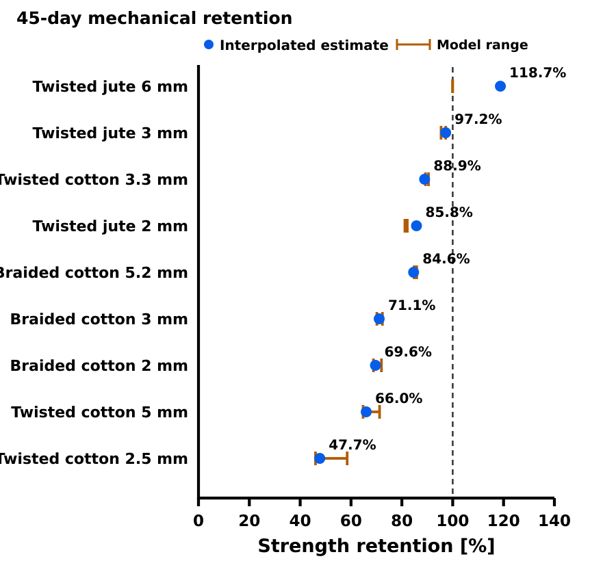
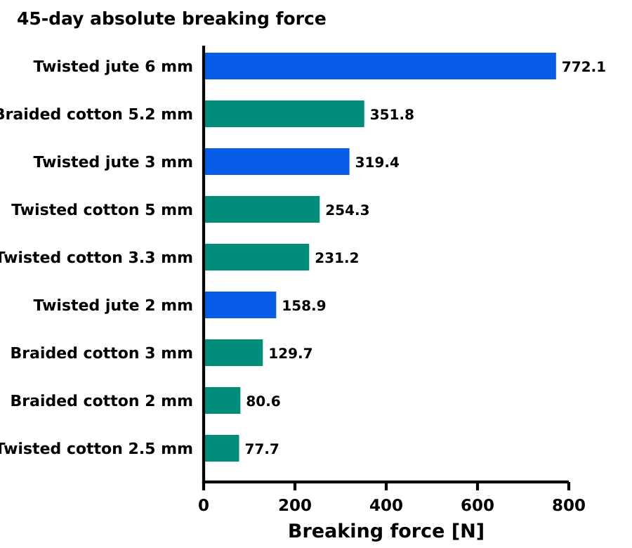

# E04 — Strength retention at a 45-day cultivation horizon

**Status:** Executed, exploratory assessment of published experiments.

## Objective
Translate E03 into a practical comparison of mechanical performance at day 45, a working cultivation horizon. The target is relative breaking-strength retention and, where directly comparable, absolute breaking force. This is not a validated farm-specific working-load recommendation.

## Method
The committed E02 mechanical core (71 records), E03 series audit (16 series), and E03 fitted parameters (59 fits) were read directly. Each condition-specific trajectory uses its matched initial observation. Day 45 is bracketed by the nearest observed times (a nominal 365.25/12 days per month is used for month-based sources). Primary retention is R45 = (1-w)R_left + w R_right, where w = (45-t_left)/(t_right-t_left). Absolute force uses the same interpolation on the reported mean, then conversion from kgf to N (9.80665) or kN to N (1000). The slight numerical rounding difference between interpolation of stored retention and original values is retained. Zhou N/ktex data remain specific force rather than inferred whole-rope force; Chamley values are relative only.

The nine exact-table configurations share a day-42/day-56 bracket. Graph-derived series are supplementary. Sparse series whose bracket starts at baseline and extends over several months are descriptive only and excluded from comparative prioritisation. No extrapolation beyond observed times is used.

For each eligible E03 kinetic fit, calculate its day-45 value using the saved scaled rate, time scale and shape/lag. The min–max of the available non-constant kinetic models represents model-form sensitivity; it is not a confidence or prediction interval. The E02 bounds, where both endpoints are available, are linearly interpolated as descriptive conditional source bounds, not propagated uncertainty; baseline uncertainty and between-study heterogeneity are not included.

## Primary results — exact tables
Source: Araya-Schmidt & Queirolo (2019), DOI 10.3856/vol47-issue1-fulltext-24, Tables 1–2. Controlled seawater at 14.5–15.5°C; twines were dried before tensile testing.

| Configuration | Retention (%) | Breaking force (N) | Kinetic model range (%) |
|---|---:|---:|---:|
| Twisted jute 6 mm | 118.75 | 772.06 | 99.90–100.00 |
| Twisted jute 3 mm | 97.23 | 319.42 | 95.43–97.26 |
| Twisted cotton 3.3 mm | 88.95 | 231.16 | 89.29–90.48 |
| Twisted jute 2 mm | 85.75 | 158.94 | 81.19–82.14 |
| Braided cotton 5.2 mm | 84.62 | 351.85 | 84.83–85.85 |
| Braided cotton 3 mm | 71.08 | 129.66 | 70.17–72.36 |
| Braided cotton 2 mm | 69.61 | 80.55 | 68.82–71.97 |
| Twisted cotton 5 mm | 65.98 | 254.27 | 64.75–71.23 |
| Twisted cotton 2.5 mm | 47.72 | 77.68 | 46.04–58.49 |

*Figure 1. Exact-table day-45 estimates and non-constant kinetic model sensitivity. The horizontal intervals are model ranges, not confidence intervals.*

*Figure 2. Absolute interpolated group-mean breaking force in newtons; not safe working load.*

Twisted jute 6 mm dominates the other exact-table configurations on these two point-estimate mechanical objectives alone. Its above-100% estimate is driven by measured group means at days 42 and 56, and is not proof of intrinsic strengthening. All E03 monotone models predict at most 100%, highlighting model misspecification for this trajectory. Within cotton, the mechanically non-dominated point-estimate options are twisted cotton 3.3 mm (higher relative retention) and braided cotton 5.2 mm (higher force). These three configurations are candidates for subsequent evidence screening, not final material recommendations. They are not geometrically matched; diameter, yarn architecture and initial strength influence the absolute-force comparison.

## Supplementary results
| Series | Day-45 retention (%) | Bracket (nominal days) | Kinetic range (%) |
|---|---:|---:|---:|
| Zhou cotton rope | 74.78 | 30.438–60.875 | 71.91–87.43 |
| Zhou jute rope | 25.96 | 30.438–60.875 | 0.97–22.55 |
| Zhou sisal rope | 39.84 | 30.438–60.875 | 37.21–42.04 |
| Rayon, biotic | 68.27 | 30.438–91.313 | 64.77–76.90 |

The large model sensitivity for Zhou jute is a practical reason to avoid unqualified model-based service-life estimates. Contrasting jute results between the twine laboratory experiment and the Zhou marine field experiment emphasise configuration and environment specificity, not a causal attribution to one variable. Graph measurements are provisional digitised observations. Abiotic rayon and PBS/PBAT at 15°C and 40°C yield only coarse descriptive interpolations over baseline-to-months brackets, and are not ranked.

## Validation and evidence boundaries
All 16 series have a bracketing interval for the target day; nine are exact-table primary, four graph-based supplementary, and three sparse descriptive. There are 46 non-constant kinetic predictions. The calculations were executed in JavaScript against the repository inputs, and a runnable JavaScript reproducer checks exact CSV agreement. A Python Colab notebook with independent-formulation checks and Figentra-style plot exports has been prepared but not executed independently. E03 model selection and E04 interpolation are not external validation. E02 digitisation and the four earlier evidence blocks remain open.

## Next: E05 — Cultivation compatibility
Integrate biological performance at the material and experimental-context level, beginning with Theobald's germling attachment and retention data and Sobuj's seaweed yield experiment. Do not transfer numerical biological endpoints across species, rope designs or experimental conditions as if measured on the E04 candidates. The eventual decision framework will include biological compatibility, mechanical requirements, environmental evidence, cost and local validation.

## Reproducibility
- [All day-45 estimates](../outputs/E04/day45_estimates.csv)
- [Kinetic sensitivity](../outputs/E04/kinetic_sensitivity.csv)
- [Primary mechanical comparison](../outputs/E04/primary_mechanical_comparison.csv)
- [Audit and source hashes](../outputs/E04/audit.json)
- [JavaScript reproducer](../scripts/E04_day45.mjs)
- [Python notebook](../notebooks/E04_45_Day_Strength_Retention.ipynb)
